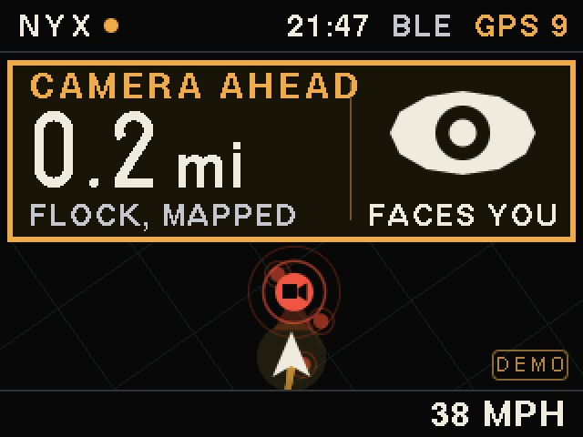
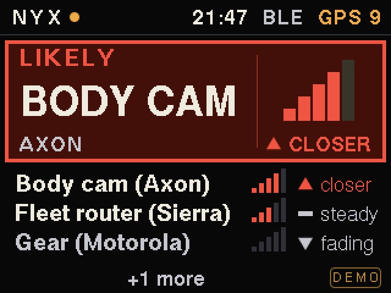
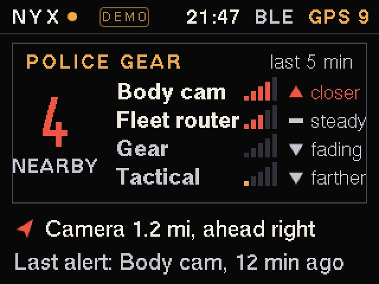
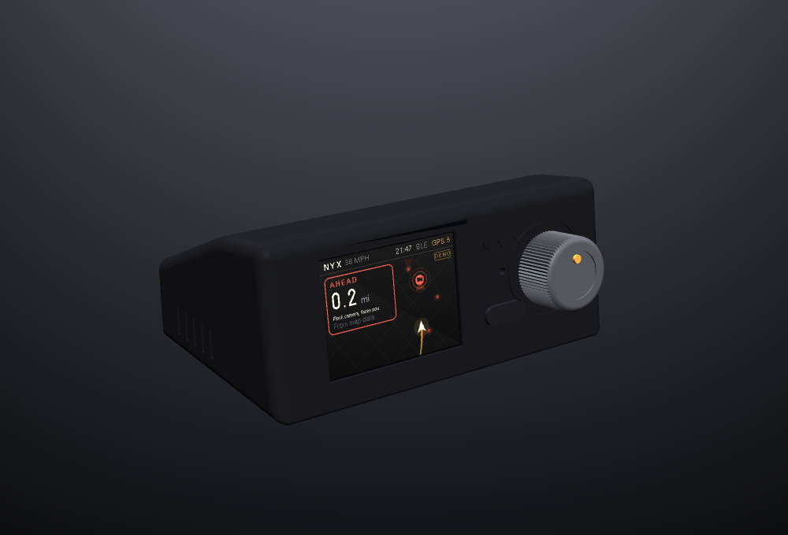
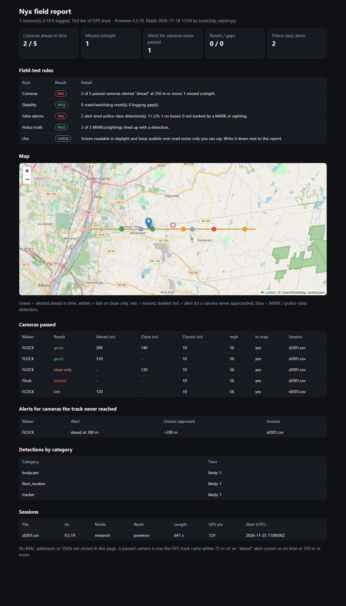

# Nyx

A dash unit that listens for police-associated Wi-Fi and Bluetooth gear and warns you about mapped plate-reader cameras by GPS. ESP32-S3, receive-only.

**Prototype.** The firmware, screen, GPS and logging work on the bench. It has not been road-tested, and no radio rule has been checked against real police hardware yet: every row in the watchlist is still `verified=no`.

| | | |
| --- | --- | --- |
|  |  |  |

These are framebuffer dumps of the firmware's demo screens, not photos of the real screen.

## What it does

- **Radio.** Hops Wi-Fi channels 1-13 and listens passively to Bluetooth adverts. Matches what it hears against a watchlist of over 100 rules: body cameras, in-car routers, radios and similar gear. Each match is rated possible, likely or confirmed and shows whether the signal is getting closer, holding or fading. Bluetooth trackers (AirTags, Tile and so on) are logged but kept out of the police count.
- **Cameras.** Reads GPS and checks it against a map of plate-reader cameras from OpenStreetMap (145,851 in the US build). It alerts "ahead" at about 300 m and "close" at about 140 m, and shows whether the lens faces you. Radio never detects Flock cameras. These alerts come from the map, not the radio.
- **Screen.** A 2.4" colour TFT with a knob, a menu, volume and mute, and a MARK button for tagging a sighting.
- **Logs.** Writes session CSVs to the board's flash and rotates old ones out. Research mode keeps every raw row (about 0.7 MB per hour). Car mode keeps only detections, marks, GPS and summaries (about 0.04 MB per hour).
- **PC tools.** Pull sessions off the board with a CRC check, load a camera map, and score a drive (`tools/trip_report.py`).

## What it can't do

- It hears 2.4 GHz only. No 5 GHz, and nothing that talks only over LTE or on 900 MHz.
- The camera map is volunteer data. Some cameras are missing, a few are stale, and about 1 in 100 has no facing direction.
- There is no accuracy or range figure for any of the radio rules. Treat a match as a hint.

## Parts

| Part | Model |
| --- | --- |
| Board | ESP32-S3-DevKitC-1 N16R8 (16 MB flash, 8 MB PSRAM) |
| Screen | 2.4" 320 x 240 SPI TFT, ILI9341 or ST7789 family (`tft chip ili` or `tft chip st`) |
| GPS | ATGM336H with a ceramic bar antenna |
| Controls | KY-040 knob, a MARK button, a mute button |
| Sound | PAM8302A amp and an 8 ohm speaker (a buzzer also works) |

No SD card is needed. [WIRING.md](WIRING.md) has every pin.



The case is a CadQuery model in [cad/case](cad/case) with STEP and STL exports. It has not been printed. Use PETG or ASA, not PLA, because a parked car gets hot.

## Build and flash

The firmware builds with PlatformIO. There are two environments: `uart` for the board's UART USB-C port and `native-usb` for the S3's own USB port. Use the cable that matches the one you flash with.

```
pio run -e uart -t upload
```

Load a camera map (see [cameras/README.md](cameras/README.md) for fetching the OpenStreetMap data), then push it to the board:

```
python -I tools/build_camera_map.py cameras/src/osm_alpr_us.json
python tools/push_cameras.py COM6
```

Opening a serial monitor on the board reboots it and starts a new session. Pull a session before you do:

```
python tools/pull_session.py s0027
```

The watchlist lives in [watchlist/signatures.csv](watchlist/signatures.csv). After editing it, run `python tools/gen_watchlist.py` and rebuild.

## Check it

- On the board, `alert-test` runs the alert logic against fixed cases.
- `python tools/tests/test_trip_report.py` runs the drive scorer on a made-up drive. It needs only the standard library.
- The `tools/test_*_native.py` scripts compile the firmware's logic on your PC and test it. They need clang++, g++ or Zig.

## Score a drive

```
python tools/trip_report.py captures/my_drive --sightings 12:31,13:05
```

It matches every camera alert to the mapped cameras you actually passed, flags alerts for cameras you never approached, counts resets and logging gaps, and applies the pass/fail rules below. The page has no MAC addresses or SSIDs in it.



That screenshot uses a made-up drive, not real data.

## Pass or fail

A first road test should clear these before anything else gets built:

- At least 4 of 5 camera alerts say "ahead" at about 300 m, and none is missed outright.
- No resets or freezes, and no lost log.
- At most one false police alert per hour, and none on buses.
- At least one MARKed police sighting lines up with a detection.
- The screen is readable in daylight and the beep is audible over road noise.

## Status

Firmware 0.5.19.

- **Verified on the bench:** GPS lock and clock, the camera alert chain on simulated drives, the screen, the knob and mute button, and antenna status (the module reports an unplugged antenna). A 12-hour soak ran with no reset and no logging gap. The alert test passes 54 of 54.
- **Open:** two unexplained `panic` reboots on 0.5.18, inside the NimBLE scan callback (`ble_scan.cpp`). They did not come back in the 12-hour soak, so the cause is not found. [CORE_DUMP.md](CORE_DUMP.md) explains how a panic is captured to flash and decoded.
- **Not built:** follower detection, 5 GHz, SD logging, a one-file image for other people's units.

## Read next

- [WIRING.md](WIRING.md): every pin, part by part.
- [docs/LOG-FORMAT.md](docs/LOG-FORMAT.md): what each column and row type in a session file holds.
- [STORAGE.md](STORAGE.md): how sessions are stored, rotated and recovered.
- [DIAGNOSTICS.md](DIAGNOSTICS.md): the counters and health notes the firmware logs.
- [DRAW_SPEED_RESULTS.md](DRAW_SPEED_RESULTS.md): how the screen was sped up and what was measured.

## Legal

Nyx only receives. The Bluetooth advertising and connecting roles are compiled out, and it transmits nothing. Rules for in-car devices and for equipment tied to police vary by place, so check yours before you mount anything.

## Credits

The watchlist collects what open-source detectors such as Flock-You look for. Camera positions are © OpenStreetMap contributors, ODbL. Bluetooth uses [NimBLE-Arduino](https://github.com/h2zero/NimBLE-Arduino).

MIT license.
