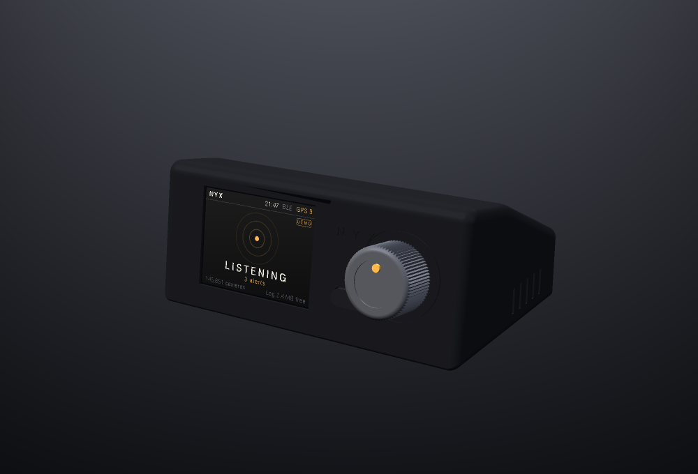

# Nyx case

A black, softly crowned wedge that follows the Nyx video: colour screen on the left of the front face, a small
column with the NYX wordmark, LED and mute button in the middle, a knurled gunmetal knob with an amber marker on the
right, and a hex speaker grille on the rear slope. About 130 x 84 x 54 mm. Three printed parts: **shell**, **base plate**,
**mute button cap**.



| | |
|---|---|
| `nyx_case.py` | the whole design as a parameter table plus code. Change a number, run it, get new files |
| `out/*.step` | for NX (File > Import > STEP) or any CAD program. `nyx_shell`, `nyx_base`, `nyx_mute_cap` are the printed parts, `ref_*` are stand-ins for the parts you buy (to check fit) |
| `out/nyx_assembly.step` | single named assembly, in millimetres, with all checked parts in place; easiest starting point in NX |
| `out/*.stl` | for slicers and for the renderer |
| `renders/*.png` | pictures of the design (front, sides, top, rear, underside, cutaway) |
| `MEASURE.md` | what to measure when the parts arrive. **Do this before printing** |

```bash
python cad/case/nyx_case.py        # rebuild the parts and run the fit check (7 s)
python cad/case/render_case.py     # redraw the pictures (30 s)
```
Needs CadQuery (tested with 2.8.0 on Python 3.12); the renderer uses numpy. Project-local installation:
`.pio/cad-tools`. Set PYTHONPATH to that folder when using the installed Python 3.12.

## 2026-11-13 revision (provisional)

The 77 x 42.5 x 1.6 mm PCB comes from the actual board's silkscreen. The front is now 55 mm nominal
(about 54.2 mm after rounding), down from 62 mm. The screen moves 5 mm right; the center controls
move 2 mm right. Internal PCB relief clears the LED collar and mute shelf. The header reservation
now follows the left short edge seen in the photo; its depth is still assumed.

The old square GPS placeholder is replaced by a horizontal bar tray integrated with the base,
plus a breakout reservation and a cable-route reference. The 33 x 14 mm open-ended tray accepts
foam shims and a soft strap. A reference ATGM336H bundle lists a 19 x 6 mm bar and a 95 mm cable:
https://muzi.works/products/gps-module-atgm336h . Those are not measurements of your antenna.
The 6 mm antenna height and 26 x 26 x 10 mm breakout are clearance reservations. The route is
about 45 mm plus a 20 mm slack allowance; check the real cable before printing. Both stay left
of the ESP32 board and away from the speaker. Cable connector contacts are excluded from the
overlap check, but the cable is checked against the shell, base and unrelated modules.

The revised model passes solid-validity and modeled-overlap checks. It is **not print-approved**:
glass offset/thickness, screen holes, SD socket depth, connector/wire envelopes, GPS dimensions,
and real antenna performance still need verification. Inspect the small fit coupons first.

## What the script checks for you

Every run builds the three printed parts and a stand-in for each bought part, then checks that each printed part is
one valid solid and that **no two parts occupy the same space** (screen board, knob and encoder, ESP32 board, speaker,
GPS bar/breakout/cable against the shell, base and each other). Today it reports `OK, nothing collides`. The check is only as good as
the dimensions in the table, which is why `MEASURE.md` exists.

## Design choices

- **Wedge with a crowned top.** Front face 55 mm nominal, rear 28 mm, a shallow front slope turning into a steeper rear slope
  with a 45 mm radius, so there is no hard ridge. All outside corners are rounded (4.5 mm on the side outline, 1 mm elsewhere).
- **Face leans back 8 degrees**, so the screen faces the driver's eyes rather than the roof.
- **Shadow gap.** The base plate sits 0.6 mm up inside the shell. That one dark line round the bottom is what makes it look
  machined instead of printed.
- **Screen window is smaller than the glass**, so the glass sits behind a 1 mm lip and the edges of the module never show.
- **Knob ring.** A 0.4 mm groove round the knob, and the nut sits in a pocket so the knob floats 1.2 mm off the face.
- **No visible screws.** Four screws go up through the base into posts inside the shell.
- **Layout.** USB-C opening and BOOT/RST pinholes at the rear, speaker grille on the slope, horizontal GPS bar
  under the slope on the left (away from the speaker magnet), side vents low at the back because a parked car gets hot.

## What is not designed yet

- **How the screen board is held.** The glass is located by a rim; the board behind it is held by foam tape until the real
  mounting-hole positions are known (they are not in any listing I can trust). Add screw posts when you have the board.
- **The ESP32 board** sits on two rails with its USB end at the rear. Its pin headers, and how wires reach the other parts,
  are not modelled.
- **A car mount.** The base has a 70 x 50 mm recess for a 3M VHB dash pad and four rubber-foot pockets. Nothing else.
- **Cable strain relief** at the USB opening.

## Printing

- **Material: PETG or ASA, not PLA** (a parked car in summer softens PLA). Black.
- Shell: print on its **rear face** (the flat rear wall on the bed), front face up. 0.16 mm layers, 3 perimeters, 25% gyroid,
  supports on the build plate only. Expect about 68 cm3 (roughly 85 g).
- Base: flat, countersunk side up. Mute cap: lie it on its flange.
- Finish: sand 400 then 800, one coat of matte black primer. ASA can be smoothed with acetone vapour.
- Test the tolerances first with just the glass window and the knob hole (a 15-minute print) before the whole shell.

## Bill of materials

4x M2.5 x 8 self-tapping screws (flat head), 4x rubber feet (9 mm), 1 dash pad (3M VHB, 70 x 50 mm), the knob and KY-040,
a 6 x 6 mm tactile switch, one 5 mm RGB LED, the TFT module, ESP32-S3 DevKitC-1, GPS module, speaker, amp board.

## Honest limits

The renders are made by a small custom renderer, not a photo-realistic one. The screen picture on them is the real firmware
output. Nothing here has been printed, and the fit has only been checked against dimensions I assumed.
